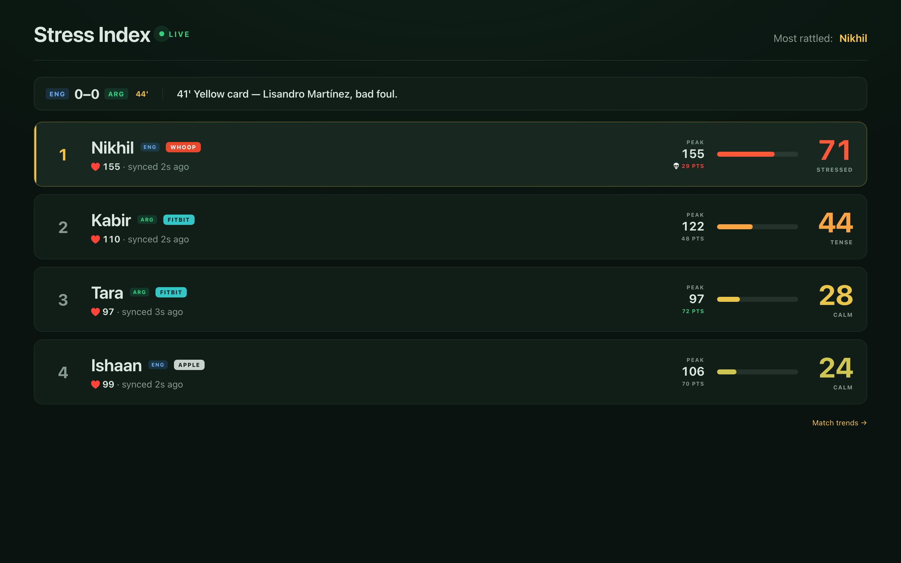
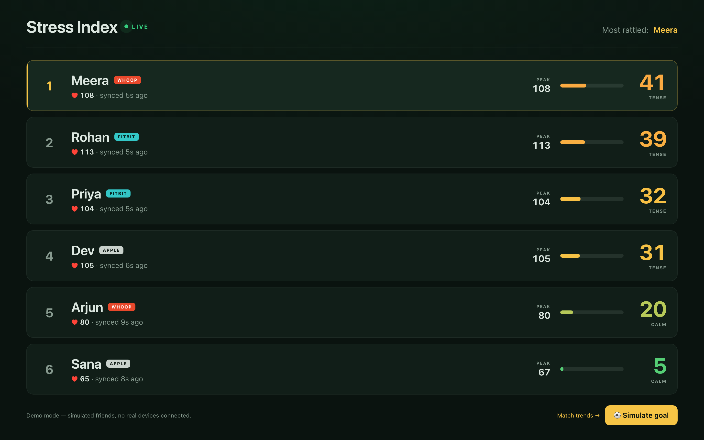
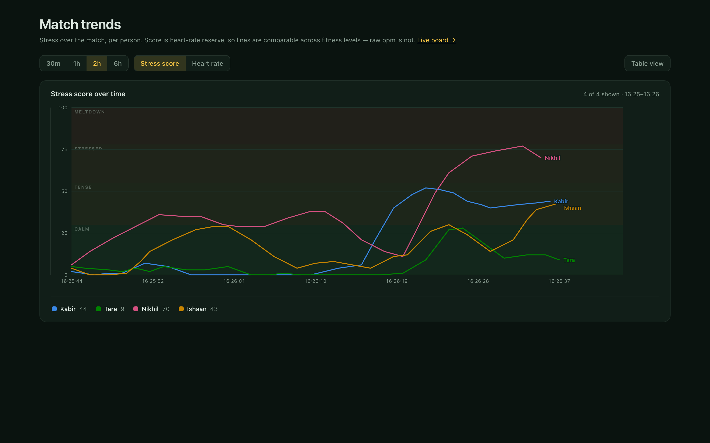
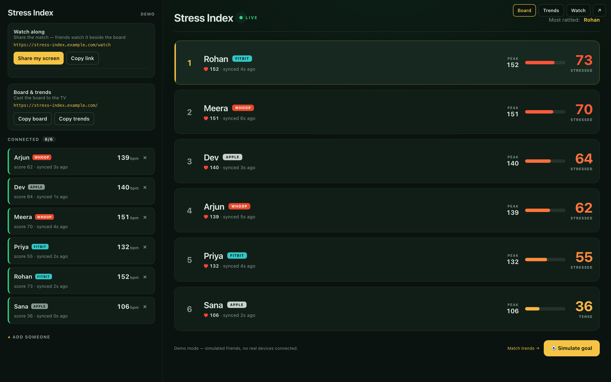

# Stress Index

**A live leaderboard that ranks your friends by how stressed they are during a football match, straight from their smartwatches.**



Cast it to the TV, start the match, and watch the board reorder from calm to meltdown as heart rates climb.

## What it does

- **Ranks people by nerve, not fitness.** The score is heart-rate reserve, so a marathon runner and a couch fan sit on the same 0 to 100 scale.
- **Reads real wearables.** Fitbit and Whoop connect through [Junction](https://docs.junction.com) (formerly Vital) with a one-tap invite link.
- **Shows its own lag.** Every card says how fresh the reading is (`synced 6s ago`) instead of pretending to be real time.
- **Replays a real match.** A built-in simulation drives four fans through a World Cup semifinal, with each heart reacting to the moments that scare their side.
- **Charts the whole game.** A trends page plots everyone's stress over time so you can find the exact minute someone lost it.

| Demo board | Match trends | Host console |
|---|---|---|
|  |  |  |

## How it works

1. The host registers a friend in the console and sends them a short invite link.
2. The friend opens it on their phone and connects their watch through Junction.
3. Junction pushes heart-rate readings to the server by signed webhook. A 60 second poll backs it up when a provider syncs slowly.
4. The server turns each reading into a stress score:

```
maxHR   = 220 - age
reserve = (latestHR - restingHR) / (maxHR - restingHR)
score   = clamp(reserve * 100, 0, 100)
```

| Score | State |
|---|---|
| 0 to 29 | Calm |
| 30 to 54 | Tense |
| 55 to 77 | Stressed |
| 78 to 100 | Meltdown |

5. The board polls every few seconds and animates rank changes.

## Run it

You need Node 20 or newer.

**Demo mode** (no devices, no API key):

```bash
npm install
npm run demo
```

Open http://localhost:8080 for six simulated friends. Hit **Simulate goal** to spike everyone. The console lives at `/admin` and the chart at `/trends`.

**Match replay** (four fans, one scripted semifinal):

```bash
MATCH_SIM=true DEMO_MODE=true npm start
```

**Real devices:**

```bash
cp .env.example .env    # add your Junction API key and webhook secret
npm start
```

Point your Junction webhook at `https://<your-host>/api/junction/webhook`. For local testing, a tunnel works well:

```bash
npx cloudflared tunnel --url http://localhost:8080
```

Port 8080 busy? `PORT=8090 npm start`.

## Honest caveats

- **Real devices need a Junction (Vital) API key.** The sandbox is free and covers up to 50 users.
- **Only cloud providers work from a browser.** Fitbit and Whoop are supported. Apple Health, Health Connect and Samsung Health live on the phone and need a native app, so they are not offered.
- **Wearables batch-sync.** Expect seconds of lag, more if someone's watch is idle. Starting a workout on the watch at kickoff makes readings far more frequent.
- **Fitbit per-minute heart rate** requires a separate intraday access approval from Fitbit.
- **State is in memory.** Deploy to a long-running host like Railway or Render, not a serverless platform.

## Useful scripts

```bash
node scripts/mock-webhook.js <vital_user_id> 150      # send a correctly signed test webhook
node scripts/demo-connect.js <vital_user_id> fitbit    # attach a sandbox demo device
node scripts/verify-signature-impl.js                  # check webhook verification against the official Svix SDK
```

## Tech stack

Node.js, Express, vanilla HTML/CSS/JS, Junction (Vital) API, Svix-style signed webhooks.
